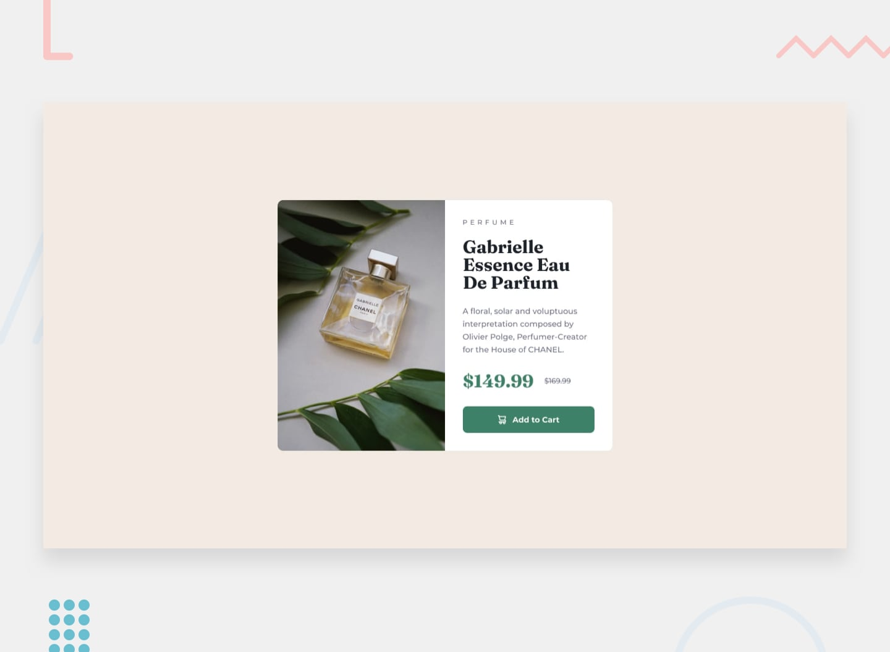

# Product Preview Card Component

A responsive product preview card built for the [Frontend Mentor Product Preview Card Component challenge](https://www.frontendmentor.io/challenges/product-preview-card-component-GO7UmttRfa).

## Overview

This project recreates a product card for Gabrielle Essence Eau De Parfum. It presents a product image, description, current and previous prices, and an Add to Cart button. The layout adapts from a vertical card on mobile to a two-column card on larger screens.

### Features

- Mobile-first responsive layout using CSS Flexbox and a media query
- Responsive image selection with HTML `<picture>` and `<source>`
- Semantic HTML for product information and pricing
- Montserrat and Fraunces typefaces
- Button hover and keyboard focus-visible styles

## Links

- [GitHub repository](https://github.com/Jeremiah-Akpor/product-preview-card-component)
- Live site: _Add the deployed URL after publishing._

## Built with

- HTML5
- CSS (nesting, Flexbox, and media queries)
- Google Fonts

## What I learned

This challenge helped me practice mobile-first styling and responsive layouts. I learned how CSS specificity can prevent a desktop override from taking effect, why flex sizing belongs on the children of a flex container when dividing space, and how `object-fit: cover` differs from setting an image's width and height. I also practiced using `<picture>` for different mobile and desktop images and improving keyboard focus visibility.

## Running locally

No build tools are required. Clone the repository and open `index.html` in a browser, or use a local development server.

## Notes

The Add to Cart button is a presentational element for this Frontend Mentor challenge and is not connected to a shopping cart.

## Author

- GitHub: [Jeremiah-Akpor](https://github.com/Jeremiah-Akpor)

## Acknowledgments

Challenge and design by [Frontend Mentor](https://www.frontendmentor.io/).
